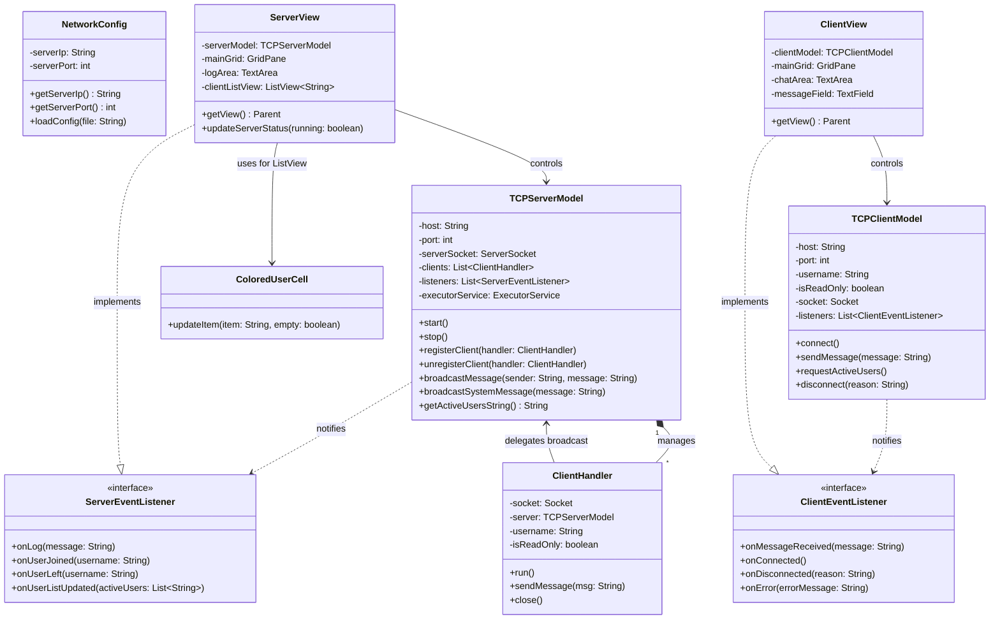
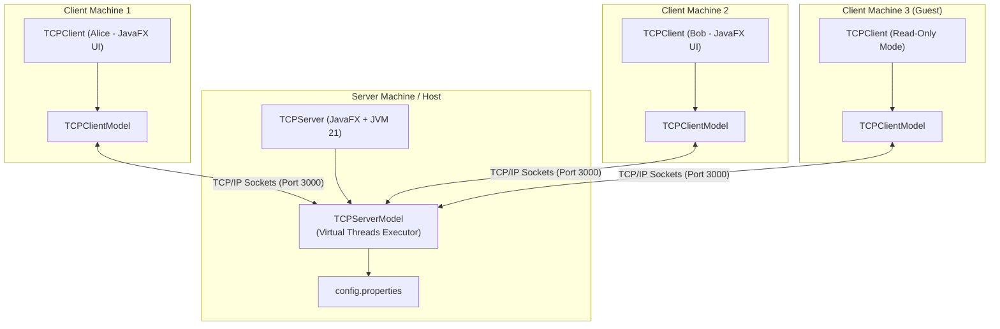
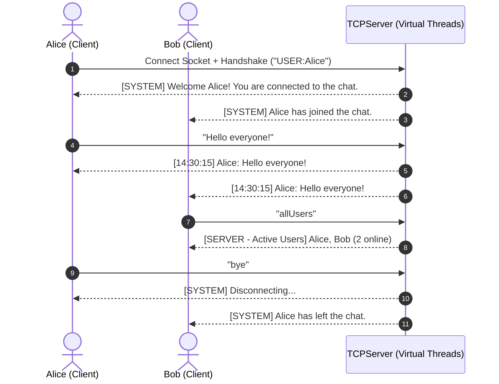

# Multi-Client Chat Application Using Java Sockets and JavaFX

A high-performance, real-time group chat application implemented using **Java 21 Virtual Threads**, **Java TCP Sockets**, and **JavaFX** with clean **Model-View Decoupling (MVC / Separation of Concerns)**.

---

## 1. System Architecture & Features

### 1.1 Central Server (`TCPServer`)
- **Concurrency with Virtual Threads:** Utilizes lightweight Java virtual threads (`Executors.newVirtualThreadPerTaskExecutor()`) to handle concurrent client connections.
- **Message Distribution:** Formats incoming messages with the sender's username and timestamp (`[HH:mm:ss] Username: Message`) and broadcasts them to all active clients.
- **Client Monitoring:** Maintains a live JavaFX `ListView` of connected users.
- **Visual Distinction:** Dynamically assigns distinct random background and text colors to different users in the client list.
- **Activity Logging:** Live activity logs display server events such as `Server Started`, `Waiting for Client`, client connect/disconnect notifications, and chat events.
- **Runtime Configuration:** Loads IP and port settings dynamically from `config.properties`.

### 1.2 Multi-Client Application (`TCPClient`)
- **Authentication & Identity:** Prompts user for a username upon launch.
- **Read-Only Mode:** If no username is provided (or if the user joins in Read-Only mode), the client is placed in **READ-ONLY MODE**, preventing them from sending messages while still receiving group broadcasts.
- **Real-Time Messaging:** Group messaging with Enter key or clicking the **SEND** button.
- **Active User Inquiry:** Typing `allUsers` (or clicking the `allUsers` quick-action button) queries the server for the list of currently active users.
- **Disconnection:** Disconnect via `end`, `bye`, or the **LEAVE** button.
- **Status Indicators:** Online status label and visual indicator circle (Green for Online, Red for Offline).
- **Decoupled Architecture:** Business logic (`TCPClientModel`) is fully decoupled from the JavaFX UI (`ClientView`).

---

## 2. Technical Architecture & UML Diagrams

### 2.1 Class Diagram


### 2.2 Deployment Diagram


### 2.3 Message Exchange Sequence Diagram


---

## 3. Modular Architecture

The project is structured into three dedicated modules:
- **`common` (`chat-common`):** Shared configurations (`NetworkConfig`) and resource files (`config.properties`, `styles.css`).
- **`server` (`chat-server`):** Server domain logic (`TCPServerModel`, `ClientHandler`), JavaFX UI (`ServerView`, `ColoredUserCell`), launcher (`TCPServerLauncher`, `TCPServer`), and integration tests (`ChatIntegrationTest`).
- **`client` (`chat-client`):** Client domain model (`TCPClientModel`), JavaFX UI (`ClientView`), and launcher (`TCPClientLauncher`, `TCPClient`).

---

## 4. Configuration

The server configuration can be customized in `common/src/main/resources/config.properties` or by placing a `config.properties` in the working directory:
```properties
# Server Configuration
server.ip=localhost
server.port=3000
```

---

## 5. How to Run the Applications

### 5.1 One-Click Launch Scripts (Windows)
You can directly double-click the batch files in the root folder to launch the apps:
- **`run-server-jar.bat`**: Double-click to run `TCPServer.jar` directly.
- **`run-client-jar.bat`**: Double-click to run `TCPClient.jar` directly.
- **`run-server.bat`**: Double-click to launch the Server GUI via Gradle.
- **`run-client.bat`**: Double-click to launch the Client GUI via Gradle.

### 5.2 Standalone Executable JAR Files
The standalone runnable `.jar` files (including all dependencies, JavaFX, and assets) are located in the `jars/` folder:
- `jars/TCPServer.jar`
- `jars/TCPClient.jar`

You can run them directly from any terminal or Command Prompt with `java -jar`:
```bash
java -jar jars/TCPServer.jar
java -jar jars/TCPClient.jar
```
Or rebuild them at any time using:
```bash
./gradlew buildJars
```

### 5.2 Running with Gradle
To launch the Server:
```bash
./gradlew :server:run
```

To launch the Client:
```bash
./gradlew :client:run
```

### 5.3 Running via Command Line / JARs
Build the standalone executable JAR files:
```bash
./gradlew serverJar clientJar
```
This produces JAR files:
- `server/build/libs/TCPServer.jar`
- `client/build/libs/TCPClient.jar`

**Start Server:**
```bash
java -jar server/build/libs/TCPServer.jar
```

**Start Client (with optional CLI parameters `<ServerIPAddress> <PortNumber>`):**
```bash
java -jar client/build/libs/TCPClient.jar localhost 3000
```

---

## 6. Running Tests
To run unit and integration tests across all modules:
```bash
./gradlew test
```
All tests verify connection handling, broadcasting, virtual thread concurrency, read-only enforcement, user inquiry commands, and disconnection protocols.
